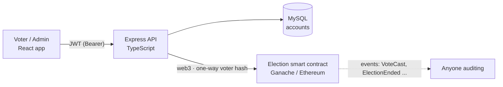

# Blockchain-based e-voting system

[](https://github.com/mohitsankhyan0770/blockchain-based-e-voting-system/actions/workflows/ci.yml)

A voting system for **colleges, clubs and other small elections**. Voters sign up and are verified by an
admin, an admin runs the election, and every vote is recorded on an Ethereum smart contract that keeps a
public, append-only audit trail.

**Stack:** Solidity · Truffle · Ganache · Node/Express · TypeScript · TypeORM · MySQL · React

> **Read the [trust model](#trust-model-what-the-blockchain-does-and-does-not-do) before using this for anything
> real.** This is a learning and small-scale project, not a replacement for a professionally audited voting system.

## How it works



1. **Sign up** with email and citizenship number. The account is *unverified* and cannot log in yet.
2. **An admin verifies** the person (this is the identity check; it happens off-chain).
3. **An admin starts an election** with a title and 2+ candidates (one atomic transaction).
4. **Verified voters vote once.** The API checks the login token, then records the vote on-chain.
5. **An admin ends the election.** Results are frozen. Anyone can see the tally.
6. **Reset** starts a clean round. Past rounds stay readable on-chain.

## Trust model: what the blockchain does and does not do

Voters are authenticated by the **backend**, not by the blockchain. The backend's wallet is the only account
allowed to record votes. So the honest summary is:

| The contract guarantees | It does **not** guarantee |
|---|---|
| One vote per voter per election | That the backend only records votes real people cast. A malicious backend operator could add votes |
| A fixed candidate list; nothing changes after the election ends | That the operator cannot link a voter to their vote (they hold the salt and can recompute hashes) |
| Only admin accounts can start, end or reset an election | Ballot secrecy against the operator, or coercion resistance |
| A public, permanent event log anyone can audit | Resistance to a compromised admin account |

What the chain **adds** over a plain database: results the operator cannot silently edit after the fact, and
an audit trail anyone can verify. Making the backend itself trustless (for example with per-voter wallets or
zero-knowledge proofs) is a much bigger design and is listed under [limitations](#limitations).

**Privacy:** names, emails and user ids are never written to the chain. A vote is stored as
`keccak256(round, userId, secret salt)` plus a candidate index. The salt is essential: user ids are small
integers, so without it anyone could hash `1..N` and match the public events to learn how each person voted.

## Security review of the first version

I reviewed my own first version and fixed what I found. Each fix has a test in `backend/test/`.

| Finding | Impact | Fix |
|---|---|---|
| `onlyAdmin` check was commented out in `Election.sol` | **Anyone** could add candidates, cast votes under invented ids, end or reset an election, and read every voter's name and choice. I reproduced all of it on a local chain | Check enforced; vote recording restricted to admins; tests for every admin function |
| API routes had no authentication | Anyone could call `/polls/start`, `/polls/end`, `/polls/reset`, `/users/verify`, `/users/delete` | `requireAuth` + `requireAdmin` on every non-public route |
| Voter id and name were read from the request body | Anyone could vote as anyone, repeatedly | Identity comes only from the verified token |
| JWT secrets were printed in source code and the README | Anyone could forge admin tokens for any deployment using them | Removed; secrets come from `.env`; the server refuses to start with weak, duplicate or previously-published secrets |
| Login and signup returned the full user row | Password hashes sent to the browser | Responses use an explicit safe shape |
| Default admin with a documented password, in a migration | Known credentials in every install | Migration is now a no-op; `npm run seed:admin` takes your own password from `.env` |
| Refresh cookie not `httpOnly`, wrong cookie name on refresh | Token readable by page scripts; refresh logic broken | `httpOnly`, `SameSite=Lax`, scoped to `/auth` |
| `/auth/login` revealed whether an email exists; no brute-force limit | Account enumeration and password guessing | One generic message, constant-time compare, rate limit on failed attempts |
| Async errors unhandled (Express 4) | Chain or DB hiccup could crash the process | `asyncHandler` + central error handler; chain outage returns `503` |
| Voter id stored in plain text on-chain | Public record of who voted and for whom | Salted hash only (see above) |
| `resetElection` looped over every voter | Gas grows with votes; could become impossible to reset | Round counter: reset costs constant gas (tested) |
| Frontend effect with no dependency list | Endless request loop | Fixed; also removed a `console.log` that printed the access token |

The old contract and the attack script are in the git history (commit `cc02df4`).

## Setup

**Prerequisites:** Node 18+, MySQL 8, [Ganache](https://trufflesuite.com/ganache/), Truffle (`npm i -g truffle`).

**1. Blockchain.** Start Ganache on port `7545`.

**2. Database.** Choose your own password (the `mysql` driver needs `mysql_native_password`):

```sql
CREATE DATABASE bbvs;
CREATE USER 'bbvs'@'localhost' IDENTIFIED WITH mysql_native_password BY '<choose-a-password>';
GRANT ALL PRIVILEGES ON bbvs.* TO 'bbvs'@'localhost';
```

**3. Backend.**

```bash
cd backend
npm install
cp .env.example .env          # Windows: copy .env.example .env
npm run gen:secret            # run three times; paste into ACCESS_TOKEN_SECRET,
                              # REFRESH_TOKEN_SECRET and VOTER_HASH_SALT in .env
# also set DB_PASSWORD in .env

truffle migrate --reset       # compiles and deploys the contract
npm run migrate               # creates the database tables

# create the first admin: set ADMIN_EMAIL, ADMIN_PASSWORD (12+ chars) and
# ADMIN_CITIZENSHIP_NUMBER in .env, then
npm run seed:admin            # afterwards, delete ADMIN_PASSWORD from .env

npm run dev                   # API on http://localhost:8000
```

**4. Frontend.**

```bash
cd frontend
npm install
npm start                     # http://localhost:3000
```

### Upgrading from the first version

- The contract changed: run `truffle migrate --reset`. Old elections are not migrated.
- Delete the old demo accounts: ``DELETE FROM `user` WHERE email IN ('john@gmail.com','liza@gmail.com','ben@gmail.com');``
- The old JWT secrets were public. If you reused them anywhere, generate new ones.
- Change the MySQL password if you used the one from the old README.

## Tests

```bash
cd backend && npm test        # no Ganache, MySQL or internet needed
cd frontend && npm run typecheck
```

The backend suite compiles the contract with `solc-js` and runs it on an **in-process Ganache chain**, and
runs the real Express app against that chain and an in-memory database:

- **Contract:** access control, input validation, double-vote prevention, ending, constant-gas reset, audit trail
- **API:** signup and login, token handling, every admin route rejecting anonymous and non-admin callers,
  full start → vote → end → reset flow, identity spoofing attempts, concurrent double votes, voter privacy on-chain,
  rate limiting, chain outage handling, configuration checks

CI runs both suites on Node 18 and 20 and builds the frontend.

## API

| Method | Path | Access |
|---|---|---|
| POST | `/auth/signup`, `/auth/login` | public, rate limited |
| POST | `/auth/check`, `/auth/logout` | refresh cookie |
| GET | `/polls/`, `/polls/status`, `/polls/votes` | public |
| POST | `/polls/check-voteability`, `/polls/vote` | verified voter |
| POST | `/polls/start`, `/polls/end`, `/polls/reset` | admin |
| GET | `/users/all` (pending users) · POST `/users/verify` · DELETE `/users/delete/:id` | admin |
| GET | `/health` | public |

## Limitations

- **Trusted backend** (see the trust model). Per-voter wallets or zero-knowledge proofs would remove this.
- **Live tally is public.** Results are visible while voting is open, which can influence late voters.
- **One election at a time**, and a single admin wallet.
- **No email verification or password reset**; identity checking is a manual admin step.
- **Not independently audited.** Do not use it for binding public elections.
- **Ideas:** hide the tally until the election ends, multiple concurrent elections, per-voter wallets,
  email verification, Docker Compose for MySQL + Ganache.
